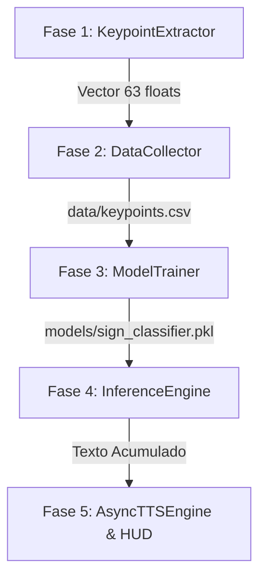

# CONTEXTO DE ARQUITECTURA Y DISEÑO TÉCNICO

## Visión General del Sistema

El **Traductor Alpha de Lenguaje de Señas** es una solución embebida y de alta velocidad diseñada para traducir dactilología estática (alfabeto de señas) a texto en pantalla y lectura hablada (TTS) en tiempo real, operando a $\ge 30\text{ FPS}$ en hardware estándar de consumo sin aceleración por GPU.

---

## Decisiones Técnicas y Razonamiento de Diseño

### 1. Detección Vectorial (MediaPipe Hands) vs. Redes Convolucionales (CNN)
- **Desafío de las CNNs:** Las redes neuronales convolucionales sobre imágenes completas BGR requieren alto poder computacional, sufren por variaciones de iluminación, fondo y tono de piel, y generan latencia en CPUs estándar.
- **Solución Vectorial:** MediaPipe Hands abstrae la mano a **21 coordenadas tridimensionales ($X, Y, Z$)**. Al trabajar sobre un vector denso de 63 números flotantes en lugar de una matriz de píxeles ($640 \times 480 \times 3$), el volumen de datos se reduce en un **$99.99\%$**, permitiendo inferencias en sub-milisegundos con algoritmos ligeros de Machine Learning.

---

### 2. Invarianza Matemática Rigurosa
Para que un gesto mantenga la misma clasificación sin importar dónde se ubique la mano en la pantalla ni qué tan cerca o lejos esté de la lente:
- **Centrado (Wrist-relative):** La muñeca (Landmark 0) se define como el origen $(0, 0, 0)$. Restar las coordenadas de la muñeca a los 20 puntos restantes elimina la dependencia de la posición $(X,Y,Z)$ en la escena.
- **Normalización Max-Absoluta:** Dividir todas las coordenadas por el valor absoluto máximo del vector centrado escala todos los valores al rango $[-1.0, 1.0]$. Esto garantiza invarianza total respecto a la distancia mano-cámara.

---

### 3. Clasificador ML: RandomForestClassifier
- **Elección:** `RandomForestClassifier` de `scikit-learn` con 100 árboles de decisión (`n_estimators=100`).
- **Ventajas:**
  - Inmune al sobreajuste en vectores de 63 características.
  - Genera fronteras de decisión no lineales complejas entre gestos similares (ej. 'M', 'N', 'S').
  - Ofrece método `predict_proba()` para obtener confianza estocástica en tiempo real.
  - Inferencia extremadamente rápida ($\approx 0.2\text{ ms}$ por muestra).

---

### 4. Debounce Buffer (Estabilidad de Gestos)
- Para evitar parpadeos causados por micro-movimientos involuntarios o transiciones entre señas, se implementa una confirmación por estabilidad de $N=15$ fotogramas consecutivos (~0.5s a 30 FPS).
- La letra solo se agrega al acumulador de texto si el mismo candidato se mantiene estable durante la ventana de tiempo especificada.

---

### 5. Arquitectura Asíncrona Non-Blocking para TTS
- **Problema de `pyttsx3`:** La llamada a `engine.runAndWait()` en `pyttsx3` es síncrona y bloquea la ejecución del hilo invocador hasta que finaliza la lectura de voz. En un bucle OpenCV, esto congelaría el fotograma de la cámara durante 1 a 3 segundos.
- **Solución:** `AsyncTTSEngine` utiliza una cola de tareas (`queue.Queue`) y un hilo en segundo plano (`threading.Thread(daemon=True)`). La captura de video y la interfaz HUD continúan a 30+ FPS fluido mientras la voz se sintetiza independientemente.

---

### 6. Temporizador Automatizado de Inactividad (3 Segundos)
- Cuando el usuario retira la mano del encuadre o mantiene la misma seña inmóvil durante 3.0 segundos continuos, el sistema interpreta que la palabra o frase está completa.
- Se dispara automáticamente la lectura por voz del texto acumulado y se reinicia la pantalla para la siguiente frase.

---

## Flujo de Trabajo en 5 Fases

